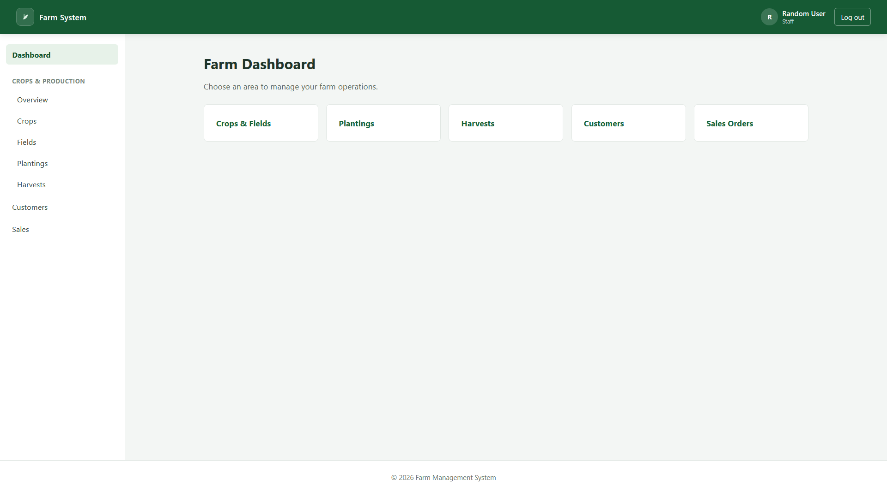

# Agribusiness Management System

A Django-based farm operations management system designed to replace fragmented paper records with a simple, reliable, centralized application.

## Project Overview

**Project name:** Agribusiness Management System

### Mission

Build a practical farm operations system that helps manage:

- Crop planting and field records
- Harvest tracking and expected harvest windows
- Customer records
- Orders and sales
- Payments and outstanding balances

The project prioritizes:

1. Simplicity
2. Reliability
3. Fast data entry
4. Easy maintenance
5. Future scalability

Version 1 is intentionally small and focused on essential farm-management workflows.

## Live Demo

**[Open the live application](https://farm-system-phi.vercel.app/)**

The application is deployed on Vercel. Visitors are directed to the login page, and authentication is required to access protected areas.

## Application Preview



*Application preview. Features and workflows are still under development.*

## Current Project Status

**Status: Active development**

The project has an established Django application structure, PostgreSQL configuration, shared templates, authentication, role-based access control, and a live deployment.

### Implemented foundations

- Django project and application structure.
- PostgreSQL database configuration.
- Production deployment on Vercel.
- User login and logout.
- Django group-based application roles.
- Account-management views and forms for managing users.
- Shared templates and dashboard routing.

These foundations are in place; individual workflows still require implementation, integration, and testing.

### Main application modules

- **Accounts:** authentication, profiles, user management, and role-based access.
- **Crops:** crop definitions, fields, and planting records.
- **Harvests:** harvest records and crop lifecycle tracking.
- **Customers:** customer information and history.
- **Sales:** orders, order items, payments, and outstanding balances.
- **Dashboard:** operational summaries, upcoming harvests, available stock, and recent sales activity.

### Development priorities

- Complete and validate business logic for each module.
- Connect related modules through consistent model relationships.
- Improve the user interface and data-entry workflows.
- Implement and test dashboard summaries.
- Add automated tests and strengthen production error handling.
- Develop harvest-calendar and reminder functionality.

## Version 1 Goals

### 1. Crop Lifecycle Management

Track:

- Crops and their maturity periods
- Fields and planting dates
- Expected harvest dates
- Harvest records and quantities

Planned benefits:

- Keep planting records organized.
- Calculate expected harvest windows.
- Identify upcoming harvests.
- Prepare for harvest reminders.

### 2. Customer and Sales Management

Track:

- Customer records
- Orders and order items
- Payments
- Outstanding balances

Planned benefits:

- Reduce dependence on paper records.
- Retrieve customer and order history.
- Track payments and unpaid balances.
- Connect sales records with harvested stock.

## Technology Stack

### Backend

- Python
- Django

Responsibilities include authentication, business rules, request handling, and database interaction.

### Database

- PostgreSQL

PostgreSQL is used for structured, relational data and integration with Django's ORM and migration system.

### Frontend

- Django Templates
- HTML
- CSS
- JavaScript where required

The initial frontend uses server-rendered templates to keep the architecture straightforward. A separate frontend framework will only be considered if a clear requirement justifies the added complexity.

### Deployment

- Vercel
- PostgreSQL hosting configured through environment-specific settings

Production secrets and database credentials must remain outside the repository.

## Architecture and App Responsibilities

The project uses separate Django apps to organize related functionality.

### `accounts`

Responsible for:

- Login and logout
- User profiles
- User management
- Application roles and permissions

Configured application roles:

- Administrator
- Farm Manager
- Harvest Manager
- Sales Manager
- Staff

Access to protected actions should be enforced on the server, not merely by hiding navigation links.

### `crops`

Responsible for crop and planting management.

#### `Field`

Represents a physical farm block.

Conceptual fields:

- Field name
- Field size
- Notes

#### `Crop`

Represents a crop type.

Conceptual fields:

- Crop name
- Maturity duration
- Unit of measurement
- Description

Example: tomatoes with a configured maturity duration and a harvesting unit such as kilograms.

#### `Planting`

Represents a particular crop planted in a field.

Conceptual fields:

- Crop
- Field
- Planting date
- Quantity planted, where applicable

A field can have multiple plantings, and a crop can be associated with multiple plantings.

### `harvests`

Responsible for recording harvest activity.

#### `Harvest`

Conceptual fields:

- Related planting
- Harvest date
- Quantity harvested
- Notes

A single planting can have multiple harvest records, allowing repeated harvesting from the same planting where appropriate.

Conceptual relationship:

`Field → Planting → Harvest`

`Crop → Planting`

### `customers`

Responsible for customer information.

#### `Customer`

Conceptual fields:

- Name
- Phone
- Location
- Notes
- Creation timestamp

Customer records should support reliable identification and retrieval of customer history.

### `sales`

Responsible for sales transactions and payment tracking.

Conceptual relationship:

`Customer → Order → OrderItem`

`Order → Payment`

#### `Order`

Represents a customer's order.

#### `OrderItem`

Represents an individual crop or product included in an order.

Conceptual fields:

- Order
- Crop or relevant product reference
- Quantity
- Unit price

#### `Payment`

Represents a payment associated with an order.

Conceptual fields:

- Order
- Amount paid
- Payment date

An order can have multiple payments. Outstanding balances should be calculated from the order total and recorded payments rather than maintained using a simple paid/unpaid Boolean.

### `dashboard`

Responsible for presenting useful operational information, such as:

- Upcoming harvests
- Available stock
- Outstanding balances
- Recent orders

The dashboard should primarily present information calculated by the relevant apps. Business rules should remain in their appropriate domain models or service logic rather than being duplicated in dashboard views.

## Core Business Rules

### Harvest Windows

The expected harvest window is calculated using the planting date and the crop's maturity duration.

Conceptually:

- Harvest start = planting date + maturity duration
- Harvest end = harvest start + 3 days

These dates should initially be calculated dynamically rather than stored as duplicate data.

The three-day range is a planning aid, not a guarantee of the actual harvest date.

### Inventory Strategy

Version 1 does not require a separate inventory app unless the business rules become too complex for the existing structure.

A basic stock calculation is:

**Available stock = harvested quantity − quantity deducted from stock**

The implementation must define when stock is deducted, how partially fulfilled orders are handled, and how cancellations or adjustments affect stock.

Example:

- Total harvested: 500 kg
- Quantity deducted from stock: 320 kg
- Available stock: 180 kg

The stock calculation should be based on actual recorded transactions, not merely the number or value of orders created.

### Calendar Feature

A calendar is planned to display:

- Planting dates
- Expected harvest windows
- Upcoming harvests

The initial target is a monthly calendar view.

### Notification System

The initial notification goal is email reminders for harvests approaching their expected harvest window.

SMS, WhatsApp, and push notifications may be considered later if there is a genuine operational need.

## Authentication Strategy

Version 1 uses Django's built-in authentication system with usernames and passwords.

Third-party authentication providers are outside the initial scope unless future requirements justify them.

Password validation, appropriate permissions, secure session handling, and protection of sensitive configuration remain important security requirements.

## Development Roadmap

### Phase 1 — Project Foundations

- Django project and app structure
- Database models and migrations
- Authentication and role foundations
- Shared templates
- Initial production deployment

**Status:** Core foundations established; ongoing validation and refinement remain necessary.

### Phase 2 — Operational Workflows

- Crop and field management
- Planting records
- Harvest recording
- Customer management
- Orders and order items
- Payment recording and balance calculations

**Status:** Implementation and integration in progress.

### Phase 3 — Operational Visibility

- Dashboard summaries
- Available-stock calculations
- Harvest calendar
- Email reminders
- Reports

**Status:** Planned and to be completed as the underlying workflows become reliable.

### Phase 4 — Quality and Reliability

- Automated tests
- User acceptance testing
- Bug fixes
- Production error handling
- Interface refinement

**Status:** Ongoing throughout development.

## Local Development Setup

### Prerequisites

- Python compatible with the project's dependencies
- Git
- PostgreSQL, if using a local PostgreSQL database

### Installation

Clone the repository:

```bash
git clone https://github.com/ProsperLePythoner/farm_system.git
cd farm_system
```

Create a virtual environment:

```bash
python -m venv .venv
```

Activate it on Windows PowerShell:

```powershell
.\.venv\Scripts\Activate.ps1
```

Install the project's dependencies:

```bash
python -m pip install -r requirements.txt
```

Configure the required environment variables in a local `.env` file according to the project's settings. Do not commit secrets or production database credentials.

Apply migrations:

```bash
python manage.py migrate
```

Start the development server:

```bash
python manage.py runserver
```

Open `http://127.0.0.1:8000/` in your browser.

**Important:** Local and production environments may use different database connections and settings. Configure each environment deliberately.

## Future Features

Potential additions outside Version 1 include:

- Weather integration
- Expense tracking
- Employee management
- Yield analytics
- Mobile application
- Dedicated inventory management
- Customer invoicing
- AI-assisted forecasting

These features should not complicate the initial architecture without a demonstrated need.

## Core Design Philosophy

### Store Facts, Calculate Results

Store operational facts such as:

- Planting dates
- Harvest records
- Orders and order items
- Payments

Calculate derived values such as:

- Expected harvest windows
- Available stock
- Outstanding balances

Avoid storing duplicate data when it can be derived reliably from authoritative records.

### Keep the System Focused

Before adding a feature, ask:

> Does this solve a real farm-management problem today?

If not, defer it until the need becomes clear.

## Repository Structure

The main project structure is organized approximately as follows:

```text
farm_system/
├── config/
├── apps/
│   ├── accounts/
│   ├── crops/
│   ├── harvests/
│   ├── customers/
│   ├── sales/
│   └── dashboard/
├── templates/
│   ├── base/
│   ├── accounts/
│   ├── dashboard/
│   ├── crops/
│   ├── harvests/
│   ├── customers/
│   └── sales/
├── static/
│   ├── css/
│   ├── js/
│   ├── images/
│   └── fonts/
├── docs/
│   ├── images/
│   ├── database_design.md
│   ├── architecture.md
│   ├── roadmap.md
│   └── business_rules.md
├── requirements.txt
├── .gitignore
├── README.md
└── manage.py
```

This is a simplified overview; the exact files may evolve as the project develops.

---

*Agribusiness Management System — built incrementally, with a focus on practical farm operations, maintainable code, and reliable records.*