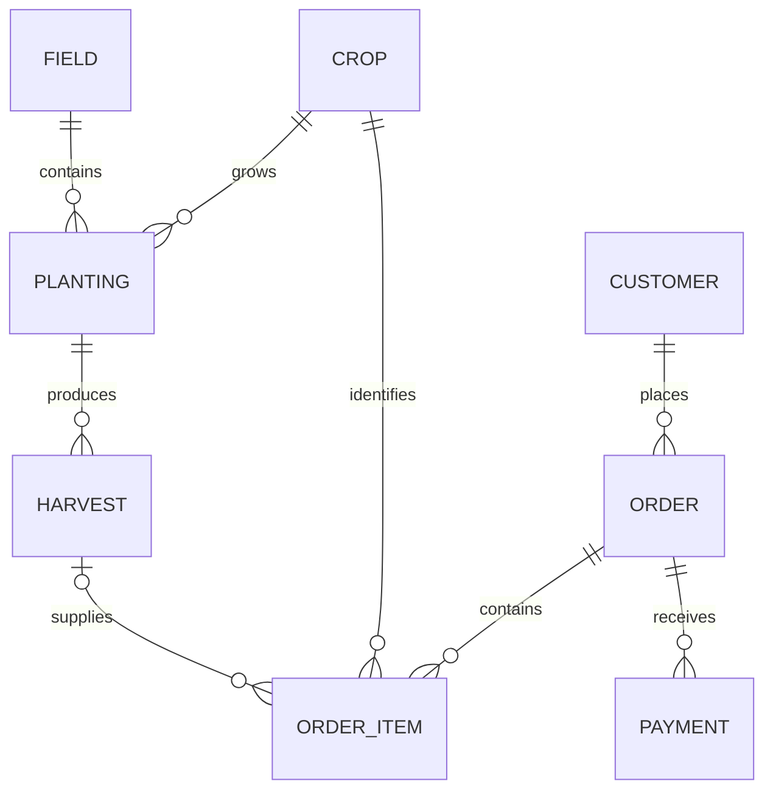

# Codebase Guide

This guide explains the current Django implementation for the next developer
(including future-you). It describes code that exists now; planned features are
labelled as such. For release and product planning, see the
[roadmap](./roadmap.md), [database design](./database_design.md), and
[view architecture](./view_architecture.md).

## 1. Start here

This is a server-rendered Django application. The browser requests a URL, Django
routes it to an app view, the view checks permissions and loads model data, and a
Django template returns HTML. The project does not currently have a separate
JavaScript frontend or an active Tailwind build pipeline.

```text
Browser
  │ HTTP request
  ▼
config/urls.py ──► app urls.py ──► view ──► form/model/database
                                      │
                                      ▼
                              Django template
                                      │
                                      ▼
                           shared base template + CSS
```

Important locations:

| Location | Purpose |
| --- | --- |
| `manage.py` | Django command-line entry point |
| `config/settings.py` | Environment, installed apps, middleware, templates, database, auth, and static settings |
| `config/urls.py` | Root URL table and app URL prefixes |
| `config/wsgi.py`, `config/asgi.py` | Application entry points used by compatible hosting servers |
| `config/view_mixins.py` | Shared protected-delete behavior |
| `apps/` | Django apps grouped by business responsibility |
| `templates/` | Shared shell and app page templates |
| `static/` | Hand-written CSS and JavaScript |
| `docs/` | Existing feature, deployment, and design notes |

### Request and permission flow

1. `config/urls.py` matches a prefix and includes that app's URL table.
2. An app URL uses a namespaced route name such as `sales:order-detail`.
   Templates and views use Django's `url` tag or `reverse()` instead of
   hard-coding generated links.
3. A class-based view loads a model/queryset and chooses a template. Forms
   validate submitted data before a view saves it.
4. `PermissionRequiredMixin` requires every permission in its
   `permission_required` tuple. Anonymous users are redirected to the login
   page; authenticated users without permission receive a forbidden response.
   The dashboard additionally requires a recognized application role.
5. The shared `templates/base/base.html` renders navigation, queued messages,
   the page content block, and the footer.
6. A deletion view may use `ProtectedDeleteMixin`: it checks a business rule
   before deletion and also handles a database `ProtectedError` if a protected
   relation is encountered.

The sidebar's permission checks only hide links. They improve navigation but
are not the security boundary; view-level checks are authoritative.

## 2. URL map

| Prefix | App and primary pages |
| --- | --- |
| `/` | Redirects to the named dashboard route |
| `/admin/` | Django admin; requires Django staff/superuser access |
| `/accounts/` | Login, POST-only logout, profile, and account management |
| `/dashboard/` | Authenticated application landing page |
| `/crops/` | Crop and field catalogues, plantings, and their details |
| `/harvests/` | Expected harvest windows and recorded harvests |
| `/customers/` | Customer list, create, detail/history, edit, and delete |
| `/sales/` | Order list, create, detail, edit, and delete |
| `/testing/` | Sign-in-protected demonstration/testing endpoints; not a farm workflow |

Use route names from each app's `urls.py` (for example,
`reverse("crops:planting-detail", args=[planting.pk])`) so URL changes do not
require rewriting links throughout templates.

## 3. Apps in the request's build order

### `config`

`settings.py` loads a local `.env` file when present, then configures Django;
the same variable names can be supplied by a deployment platform. The project
uses PostgreSQL. `DATABASE_URL` takes precedence; otherwise settings read the
individual PostgreSQL variables listed below. The tracked SQLite file is not
the database configured by these settings.

`INSTALLED_APPS` registers Django's admin/auth/session/static apps and the
project's accounts, crops, customers, dashboard, harvests, sales, and testing
apps. App modules use the `apps.<name>` import path. Templates are found in the
shared `templates/` directory and in installed apps. The account context
processor adds `account_role_display` for the top navigation.

The root URL configuration mounts each app. WSGI and ASGI modules set
`DJANGO_SETTINGS_MODULE` to `config.settings` before creating Django's
application callable.

`ProtectedDeleteMixin` gives delete pages a friendly blocked state. It returns
HTTP 409 when the app's pre-check blocks deletion or Django raises
`ProtectedError`; a concrete delete view supplies its rule and messages.

### `accounts`

The project uses Django's built-in `User`, `Group`, and model permissions; it
does not define a custom user model or public sign-up. The `setup_roles`
management command synchronizes the standard application groups and
permissions. Run it after migrations and rerun it when the role matrix changes.

Application Administrator is a group, not Django `is_superuser` or `is_staff`.
Only a trusted superuser can assign the Administrator role. Account views
prevent a non-superuser Administrator from editing themselves or another
Administrator; trusted superusers can manage those accounts. The edit/toggle
flows prevent self-deactivation and guard the last active trusted administrator,
and the dedicated toggle action rejects a self-target. Django admin has
separate checks. Logout is a CSRF-protected POST, inactive accounts cannot
continue using protected views, and users can edit only their own first/last
name through the profile form.

The template context processor displays the first recognized role name in
alphabetical order, falling back to `Superuser` for a superuser without a
recognized group. Managed accounts are intended to have one application role.

Current role permissions (the setup command applies these to Django groups):

| Role | Current application permissions |
| --- | --- |
| Administrator | All operational model actions (view/add/change/delete) and user view/add/change permissions; account views impose additional safeguards. |
| Farm Manager | All operational model actions for crops, fields, plantings, harvests, customers, orders, order items, and payments. |
| Harvest Manager | Read crops, fields, and plantings; view/add/change harvests. |
| Sales Manager | Read production and harvest data; view/add/change customers, orders, order items, and payments. |
| Staff | Read operational data except payment records and payment balances. |

`ROLE_PERMISSIONS` is the source for this table. Custom view gates and the
template's permission checks determine which pages/actions use those model
permissions. Group membership alone does not grant Django admin access.

### `crops`

This app owns the production catalogue:

- `Crop`: unique crop name, maturity duration, controlled output unit, and
  optional description.
- `Field`: unique plot/block name, size in acres, and optional notes.
- `Planting`: links one crop to one field and records planting date and
  quantity/unit.

`Planting.harvest_start` is calculated each time as
`planting_date + crop.maturity_days`; it is not stored. `harvest_end` is
`harvest_start + 2 days`, so the inclusive window covers three calendar dates.
Changing a crop's maturity duration changes the calculated window of its
existing plantings. The current ready helper compares today's local date with
the start date; the harvest list separately includes windows whose end is not
before today.

Crop and field list/detail/create/edit/delete views use Django permissions.
Planting detail shows related harvest records. Deletion is blocked when a crop
is used by plantings or sales, a field has plantings, or a planting has
harvests.

`apps/crops/crops_ui.txt` is a text mockup of an intended overview screen. Treat
it as a planning sketch; the implemented overview is defined by the crop view
and its Django template.

### `harvests`

`Harvest` is a single recorded event linked to one planting; a planting may
have multiple harvests. The record stores a date, positive quantity, unit, and
optional notes. Model/form validation prevents a harvest date before planting.
When a harvest is created from a planting, the view copies that crop's current
unit onto the harvest. That stored unit preserves the historical label if the
crop catalogue unit later changes.

`HarvestListView` supplies two separate collections to the page:

- `upcoming_plantings`: planting-derived expected windows that have not ended,
  including a window already in progress. It does not currently remove a
  planting merely because one or more harvests have been recorded.
- `harvests`: actual `Harvest` rows, ordered newest first.

The planting-specific `Record Harvest` link opens the create view with that
planting in the URL. A harvest referenced by an order item cannot be deleted.

### `customers`

`Customer` stores a person/business name, phone, optional location and notes,
and creation timestamp. Its detail page prefetches related orders and displays
customer history. Create/edit forms are model forms; list filtering/search is
not implemented. Deletion is blocked when the customer has orders, preserving
the historical relationship.

### `sales`

The current structure separates:

- `Order`: customer, date, notes, and timestamps.
- `OrderItem`: order, crop, optional harvest, quantity, unit snapshot, and unit
  price.
- `Payment`: one amount/date installment linked to an order.

An order form and inline formset save the parent order and line items in one
database transaction. The formset requires at least one remaining item. New
items require a harvest in the form; the model keeps `harvest` optional so
older crop-only records remain readable. When a harvest is selected, the item
copies its crop and unit from that harvest. The model validation also rejects a
harvest whose crop differs from the item's crop. As with normal Django models,
calling `.save()` directly does not automatically call `full_clean()`.

`line_total` is `quantity * unit_price`; `Order.total_amount` sums line totals;
`total_paid` sums related payments; and `outstanding_balance` subtracts paid
from total. `status` returns `pending`, `partial`, or `paid` based on those
values. These are computed properties, not stored order columns. There is no
payment-entry route/form yet; payment records are available in the model and
Django admin. No payment-overdue rule or stock deduction/availability check is
implemented.

### `dashboard`

`DashboardView` requires a signed-in user and a recognized application role.
The page is currently a permission-filtered set of navigation links. It does
not yet calculate upcoming harvest cards, available stock, recent orders,
revenue, or customer balances.

### `testing`

This app contains small sign-in-protected demonstration endpoints and a simple
name form. It is not part of the production farm workflow and currently
contains debug/demo code; review `apps/testing/views.py` before exposing or
expanding it.

## 4. Data relationships



`o|` on the order-item/harvest relationship means an order item can have zero
or one harvest: zero is retained for legacy crop-only sales. A harvest can be
referenced by multiple order items. Stock is not a separate model or ledger in
the current implementation, so these relations alone do not prove availability.

Deletion policies reinforce history: crop/field/planting/harvest/customer
references use protected deletion where appropriate; deleting an order cascades
to its items, while an order with payments is refused by the app's delete view.
The full built-in model relationships are described in
[database design](./database_design.md).

## 5. Forms, templates, and static files

Most CRUD pages use Django generic class-based views with a `ModelForm`.
`templates/base/base.html` is the shared shell and defines the page title,
content, and optional asset blocks. The navbar displays the signed-in user's
full name (or username), role, and POST logout form. The sidebar hides links
based on `perms`; it does not replace backend view authorization.

The sales order form uses a Django inline formset. Its management form contains
the counts Django needs to bind/save repeated item forms. Keep it in the HTML
form when editing that template.

The hand-written frontend assets are under `static/css/` and `static/js/`.
`STATICFILES_DIRS` points Django to `static/`; `STATIC_ROOT` is the destination
for `collectstatic`. The dependency file still lists Tailwind-related packages,
but Tailwind is not registered in `INSTALLED_APPS` and the current templates do
not load it as an active build pipeline.

## 6. Configuration variables

Do not commit or paste credentials. `python-dotenv` loads a local `.env` when
present; deployment variables should be set in the hosting platform's private
configuration.

| Variable | Purpose and current behavior |
| --- | --- |
| `DJANGO_SECRET_KEY` | Required signing key. There is no source-code fallback; unset configuration makes Django's system check fail. |
| `DJANGO_DEBUG` | Enables debug mode only when the value is `true` (case-insensitive); missing defaults to false. |
| `DJANGO_ALLOWED_HOSTS` | Optional comma-separated hostnames. An empty list is not suitable for normal hosted requests. |
| `VERCEL_URL` | If present, appended as an allowed hostname; provide a hostname without a URL scheme. |
| `DJANGO_CSRF_TRUSTED_ORIGINS` | Optional comma-separated trusted origins for CSRF-protected cross-site POSTs; include the scheme when configuring an origin. |
| `DATABASE_URL` | Preferred hosted PostgreSQL connection. Settings request SSL and set `conn_max_age=0`; see the open question in [DOCS_NOTES.md](../DOCS_NOTES.md). |
| `DB_NAME`, `DB_USER`, `DB_PASSWORD`, `DB_HOST`, `DB_PORT` | PostgreSQL fallback used when `DATABASE_URL` is absent. The settings do not supply useful defaults, so configure the required connection values. |

Password validation is enabled with Django's user-attribute similarity,
minimum-length, common-password, and numeric-password validators. The project
uses UTC-aware datetimes (`USE_TZ = True`, `TIME_ZONE = "UTC"`).

## 7. Local development and useful commands

Run commands from the repository root in PowerShell. First create and activate a
virtual environment, then install the pinned requirements. Configure the
environment variables above privately before starting Django.

```powershell
python -m venv .venv
.\.venv\Scripts\Activate.ps1
python -m pip install -r requirements.txt

python manage.py check
python manage.py showmigrations --plan
python manage.py migrate
python manage.py setup_roles
python manage.py createsuperuser
python manage.py runserver
python manage.py test
```

Useful migration workflow:

```powershell
python manage.py makemigrations
python manage.py sqlmigrate app_label migration_number
python manage.py migrate
```

Review generated migrations before applying them, especially against a hosted
database. `setup_roles` should be run after migrations so Django has generated
the model permissions used by the command. Create a trusted superuser through
the controlled environment; do not put its credentials in source files or
documentation.

## 8. Testing map

The app tests use Django's `TestCase` and test-client to cover relevant user
flows:

- `apps/accounts/tests.py`: login/logout, role setup, permission boundaries,
  user-management safeguards, and profile/navigation behavior.
- `apps/crops/tests.py`: catalogue CRUD, planting relationships, and protected
  deletes.
- `apps/harvests/tests.py`: validation, expected windows, record/edit/delete,
  and the planting-to-harvest lifecycle.
- `apps/customers/tests.py`: contact CRUD, order history, and delete protection.
- `apps/sales/tests.py`: order forms/formsets, calculated totals, legacy items,
  harvest references, and delete protection.
- `apps/dashboard/tests.py`: shared-shell rendering and root redirect.
- `apps/testing/tests.py`: authentication boundary for demonstration routes.

Run `python manage.py test` for the whole suite. When changing one app, run its
label (for example `python manage.py test apps.harvests`) and then the complete
suite before considering the change verified. Tests need the configured test
database; a successful syntax check alone does not prove application behavior.

## 9. Small glossary

| Term | Meaning here |
| --- | --- |
| Django app | A package grouping related models, views, routes, templates, and tests |
| Model | Python class describing persisted data and its relationships |
| Migration | Versioned schema change generated from model changes |
| Queryset | Lazy database query that selects model rows |
| `select_related` | Join a single-valued relation into a query |
| `prefetch_related` | Fetch a multi-valued relation separately and reuse it |
| Model form | Form whose fields and validation are based on a Django model |
| Inline formset | Several child forms managed and saved with one parent record |
| Permission | Django model action such as `sales.change_order` |
| Group | Named set of Django permissions used as an application role |
| Context | Values a view passes to a template for rendering |
| Snapshot | A copied value (such as unit) retained on a record for historical display |
| Protected deletion | Refusing deletion while related business history depends on the record |

## 10. Future-you checklist

When adding a business feature:

1. Decide which app owns the data and rules; avoid making templates the source
   of business logic.
2. Update the model, create/review the migration, and add model/form validation
   where the rule belongs.
3. Add or update the view and named URL; include every required permission.
4. Update the template without treating hidden links as authorization.
5. Add tests for both the allowed workflow and its important invalid/denied
   cases.
6. Update this guide and the domain document when the implemented behavior
   changes.
7. Run Django checks and the relevant tests, then inspect the full diff.

For current open questions, documented mismatches, and intentionally skipped
files, see [DOCS_NOTES.md](../DOCS_NOTES.md).
